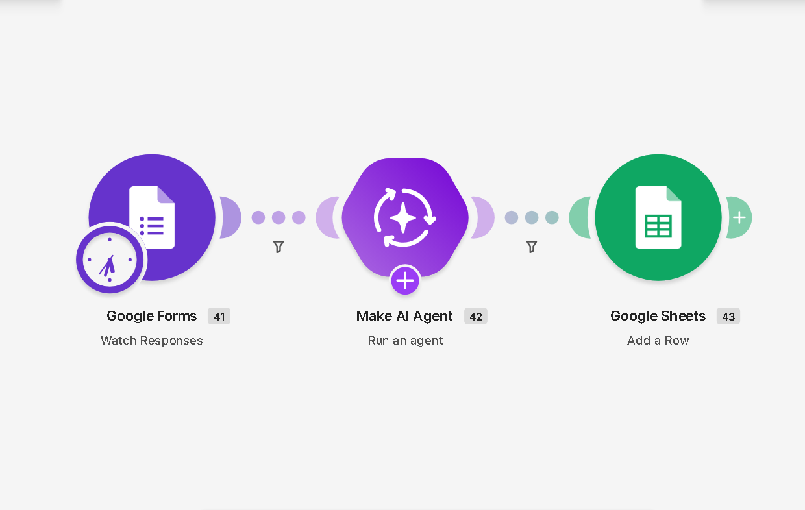
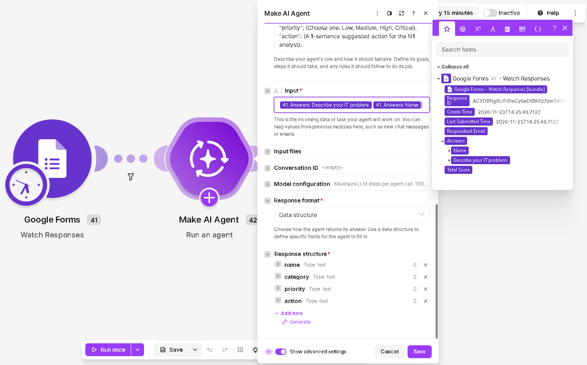
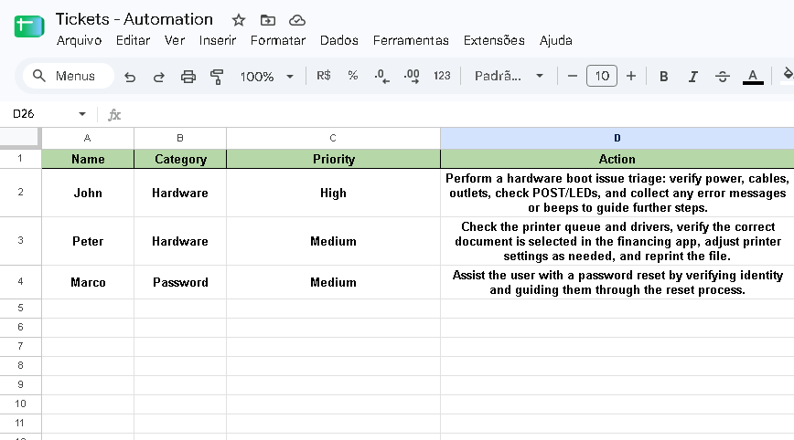

# 🤖 Automação de Triagem de Chamados com Inteligência Artificial

## 📌 Sobre o Projeto
Este projeto é uma automação construída no **Make.com** que utiliza Inteligência Artificial para realizar a triagem inicial de chamados de suporte técnico (Helpdesk N1). 

O objetivo é reduzir o tempo gasto por analistas na leitura e categorização manual de tickets, padronizando o registro das informações e agilizando o tempo de resposta (TMA).

## ⚙️ Como o fluxo funciona
1. **Formulário (Trigger):** O usuário preenche um formulário no Google Forms relatando o problema de TI.
2. **Agente de IA:** O Make.com captura a resposta e envia o texto para um Agente de IA.
3. **Estruturação de Dados (JSON):** Através do recurso *Data Structure* do Make, a IA é forçada a responder em um formato JSON estruturado, retornando:
   - `category` (Hardware, Software, Network, Password)
   - `priority` (Low, Medium, High, Critical)
   - `action` (Ação sugerida para o analista N1)
4. **Registro (Output):** Os dados são inseridos automaticamente e separados em colunas em uma planilha do Google Sheets, simulando a entrada em um CRM ou sistema de Ticketing.

## 🛠️ Tecnologias Utilizadas
- **Make.com:** Orquestração da automação.
- **Make AI Agent:** Processamento de linguagem natural (NLP) para triagem.
- **Google Forms:** Captura de dados do usuário.
- **Google Sheets:** Banco de dados e simulação de CRM.
- **JSON:** Estruturação de dados para integração perfeita entre os sistemas.

## 📸 Demonstração

## 🚀 Aprendizados
- Integração de APIs e plataformas de automação.
- Engenharia de Prompt (Prompt Engineering) voltada para Suporte Técnico.
- Estruturação de dados (JSON) para garantir consistência nas informações.
- Aplicação prática de conceitos de ITIL (Triagem e Priorização).
